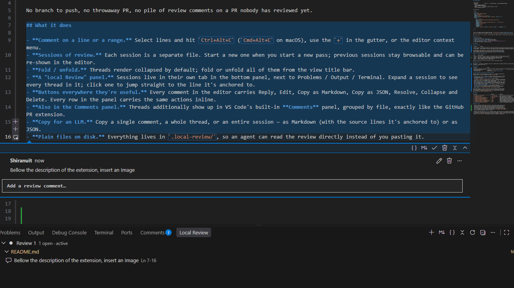

# Local Change Review

Review your **local, uncommitted** changes with GitHub-PR-style inline comments — then copy the whole review as Markdown or JSON and hand it to an LLM to fix.

No branch to push, no throwaway PR, no pile of review comments on a PR nobody has reviewed yet.

## What it does

- **Comment on a line or a range.** Select lines and hit `Ctrl+Alt+C` (`Cmd+Alt+C` on macOS), use the `+` in the gutter, or the editor context menu.
- **Sessions of review.** Each session is a separate file. Start a new one when you start a new pass; previous sessions stay browsable and can be re-shown in the editor.
- **Fold / unfold.** Threads render collapsed by default; fold or unfold all of them from the view title bar.
- **A "Local Review" panel.** Sessions live in their own tab in the bottom panel, next to Problems / Output / Terminal. Expand a session to see every thread in it; click one to jump straight to the line it's anchored to.
- **Buttons everywhere they're useful.** Every comment in the editor carries Reply, Edit, Copy as Markdown, Copy as JSON, Resolve, Collapse and Delete. Every row in the panel carries the same actions inline.
- **Also in the Comments panel.** Threads additionally show up in VS Code's built-in **Comments** panel, grouped by file, exactly like the GitHub PR extension.
- **Copy for an LLM.** Copy a single comment, a whole thread, or an entire session — as Markdown (with the source lines it's anchored to) or as JSON.
- **Plain files on disk.** Everything lives in `.local-review/`, so an agent can read the review directly instead of you pasting it.



## Build & install

```bash
pnpm install
pnpm run compile          # or: pnpm run watch
pnpm run package          # produces local-change-review-<version>.vsix
code --install-extension local-change-review-*.vsix
```

Or press `F5` in this folder to launch an Extension Development Host.

The panel is at **View → Appearance → Panel**, tab **Local Review**.

## Storage layout

```
.local-review/
  index.json              { "version": 1, "activeSessionId": "session-20260911-143000" }
  sessions/
    session-20260911-143000.json
    session-20260912-091200.json
  exports/                written by "Export Session to File…"
    session-20260911-143000.md
```

A session file:

```json
{
  "version": 1,
  "id": "session-20260911-143000",
  "name": "Session 1",
  "status": "open",
  "createdAt": "2026-09-11T14:30:00.000Z",
  "base": { "branch": "feat/billing", "sha": "a1b2c3d4…", "dirty": true },
  "threads": [
    {
      "id": "thread-…",
      "path": "src/features/assistant/AssistantBilling.service.ts",
      "startLine": 33,
      "endLine": 36,
      "snippet": ["export class AssistantBillingService {", "  constructor("],
      "languageId": "typescript",
      "status": "open",
      "createdAt": "…",
      "updatedAt": "…",
      "comments": [
        { "id": "comment-…", "author": "Shiranuit", "body": "…", "createdAt": "…" }
      ]
    }
  ]
}
```

`path` is workspace-relative and POSIX-separated. `startLine`/`endLine` are **1-based and inclusive**. `snippet` is the source the comment was anchored to, captured (and refreshed) as you edit — so an export is readable without opening the file.

Add `.local-review/` to `.gitignore` if you'd rather not commit reviews, or commit them if you want the history.

## Typical loop

1. Make local changes.
2. **Local Review: Start New Review Session**.
3. Select lines, `Ctrl+Alt+C`, write what's wrong. Repeat.
4. **Copy All Comments as Markdown** from the view title bar.
5. Paste into your agent: *"Here is a review of the current working tree, fix it."*
6. Start the next session to review the fixes.

## Commands

### In the editor

| Toolbar       | Actions                                                                                               |
| ------------- | ----------------------------------------------------------------------------------------------------- |
| Thread header | Copy Thread as JSON · Copy Thread as Markdown · Resolve/Unresolve · Delete Thread · Collapse Thread   |
| Each comment  | Edit · Delete, with Edit, Copy Comment as JSON, Copy Comment as Markdown and Delete Comment under `…` |

Thread-scoped actions appear once, on the thread; comment-scoped actions appear
on each comment. Replies go in the thread's reply box. Session-scoped actions
(copy everything, new session, delete session) are in the **Local Review** panel.

### In the **Local Review** panel

| Row     | Inline buttons                                                                 |
| ------- | ------------------------------------------------------------------------------ |
| Session | show/hide in editor · Copy all as Markdown · Copy all as JSON · Delete session |
| File    | Copy File's Threads as Markdown · Copy File's Threads as JSON                  |
| Thread  | Copy as Markdown · Copy as JSON · Resolve/Unresolve · Delete                   |
| Reply   | Copy as Markdown · Copy as JSON · Delete                                       |

Right-click any row for the rest: set active, rename, close/reopen, export.

### Panel title bar

New Session `+` · Copy All as Markdown · Copy All as JSON · Fold All Threads · Redraw, with Switch Session, Export, Unfold All, Comments panel and Reveal storage folder under `…`.

### Elsewhere

| Command                         | Where                                                                                  |
| ------------------------------- | -------------------------------------------------------------------------------------- |
| Add Review Comment on Selection | `Ctrl+Alt+C`, editor context menu, gutter `+` — all three only while a session is open |
| Switch Active Session…          | status bar                                                                             |
| Everything above                | Command Palette, under **Local Review**                                                |

## Living alongside the GitHub Pull Request extension

Both extensions put comment threads on the same `file:` documents and share the
Comments panel, so this one deliberately stays out of the way:

- **Nothing on non-`file:` documents.** PR diffs, PR descriptions and every other
  virtual document are never touched — the gutter there belongs entirely to the
  Pull Request extension.
- **No gutter `+` until you start a session.** With the default
  `localReview.commenting: "whenSessionActive"`, the `+`, the editor context-menu
  entry and `Ctrl+Alt+C` only appear once a review session is open. Until then the
  gutter looks exactly as it did before you installed this.
- **Auto-suspend during a PR review.** While a pull request review is open, Local
  Review suspends itself: no gutter affordance, and its threads leave the editor
  *and* the Comments panel, so they can't be mistaken for PR comments. The status
  bar says so, and one click resumes.
- **Manual suspend.** **Local Review: Suspend** from the palette or the panel's
  `…` menu does the same on demand, and is remembered per workspace.
- **Distinct label.** Our threads are labelled `Local Review` in the Comments
  panel, against `Pull Request (owner/repo)` for the other extension.

Auto-suspend detects a review by looking for open tabs whose URI scheme belongs
to the Pull Request extension. There is no API for its review mode, so that list
is the setting `localReview.pullRequestSchemes` — if detection misfires either
way, edit the list rather than waiting for a fix.

## Settings

| Setting                                   | Default             | Meaning                                                                   |
| ----------------------------------------- | ------------------- | ------------------------------------------------------------------------- |
| `localReview.storageFolder`               | `.local-review`     | Where sessions are stored. Set to `.vscode/local-review` to tuck it away. |
| `localReview.author`                      | *(git `user.name`)* | Name recorded on new comments.                                            |
| `localReview.defaultThreadState`          | `collapsed`         | How threads render in the editor.                                         |
| `localReview.highlightCommentedLines`     | `true`              | Highlight commented ranges and mark them in the overview ruler.           |
| `localReview.showStatusBarItem`           | `true`              | Active session + open-thread count in the status bar.                     |
| `localReview.markdown.includeCode`        | `true`              | Embed the commented source in Markdown exports.                           |
| `localReview.markdown.includeLineNumbers` | `true`              | Prefix embedded source with line numbers.                                 |
| `localReview.markdown.includeResolved`    | `false`             | Include resolved threads when exporting a session.                        |
| `localReview.markdown.maxCodeLines`       | `40`                | Truncate long embedded snippets.                                          |

## Notes & limits

- Comment threads are drawn about 1.5s after a file becomes visible, and only for
  files you have open. That works around a VS Code bug: a comment widget that is
  already drawn when the Git extension registers quick-diff for the file gets
  duplicated, and the extra widget cannot be disposed by the extension that owns
  it. A consequence is that the built-in Comments view lists threads only for open
  files; the Local Review panel always lists everything. `localReview.renderDelayMs: 0`
  restores immediate drawing if you don't use Git.

- Sessions are stored under the **first** workspace folder. Files outside it are recorded by absolute path.
- Thread anchors follow edits while the file is open in the editor, and are written back on save. Edits made to a file by an external tool while it is closed will leave anchors pointing at the old line numbers — `snippet` still records what was commented on.
- Editing `.local-review/**` from outside the editor is picked up automatically.
